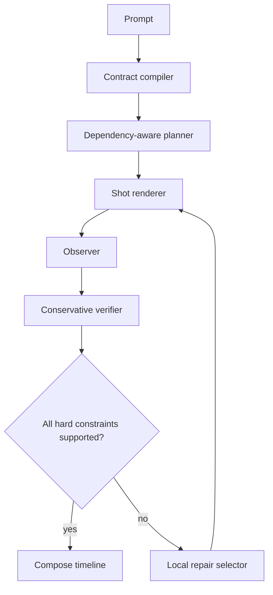

# Architecture

Contract2Video separates four responsibilities so that planning and language reasoning cannot be mistaken for media evidence.

## Contract layer

A contract contains a prompt, stable entities, ordered shots, planning state, and scoped constraints. Shot order is the timeline order. A dependency must point to an earlier shot. The validator checks uniqueness, positive durations, reference resolution, allowed constraint kinds, nonempty scopes, and acyclic ordering.

The `state_in` and `state_out` fields are useful for planning transitions, such as a character's location or whether an object has crossed a landmark. They are never sufficient to accept a rendered clip.

## Rendering layer

The renderer receives one shot at a time together with optional repair feedback and reference clips. It writes a target asset and returns a `RenderedShot` with path, measured duration, attempt, seed, cost, and metadata. The procedural renderer is a deterministic reference implementation. The command renderer wraps a user-specified executable. The Wan adapter is an optional integration boundary and must not load model weights during package import.

Every attempt, including failed calls, is preserved in a versioned shot directory and represented in `trace.jsonl`. A pre-call cost estimate is checked before invoking an external service. Existing nonempty output directories are rejected to prevent accidental overwrite or mixed runs.

## Observation layer

An observer maps rendered assets to `Evidence`. Evidence is scoped to constraints and must include timestamp spans and clip hashes for every non-unknown verdict. Sources may include a local vision-language model, object tracking, OCR, ASR, or deterministic checks. The scripted observer is fixture-only and exists to exercise schema validation and controller branches; it must never be used to claim perceptual quality.

Observation runs after each render wave. Cross-shot identity and temporal constraints are recomputed after any changed shot, so stale observations cannot silently survive a repair.

## Verification and control

For each constraint, reliable contradiction takes precedence over support. Support requires complete scope coverage with valid hashes and spans. Missing, stale, malformed, or conflicting records are `unknown`. Unknown hard constraints do not pass acceptance.

The controller stops with one of four statuses:

- `accepted`: every hard constraint is supported;
- `unresolved`: the budget remains but a round ends with unresolved evidence;
- `budget_exhausted`: a render, round, or cost budget prevents another attempt;
- `failed`: an implementation error prevents a valid run.

Local repair takes the scopes of violated or unknown constraints and adds transitive dependents in original order. Full repair rerenders the complete timeline. Single mode limits repair to a selected shot for controlled comparisons. Soft constraints are reported independently and do not block acceptance.

## Output contract

A successful or unresolved run emits:

- `manifest.json` with status, budgets, rates, decisions, assets, errors, and timing;
- `trace.jsonl` with render requests and outcomes;
- `evidence.jsonl` with validated observer records;
- a redacted `config.json` and a copied `contract.json`;
- versioned assets under `shots/`;
- `final.mp4` when all timeline shots exist, labeled by the manifest status.

The manifest records `evidence_mode` (`scripted` or `vlm`) so downstream analysis can reject fixture runs when real evaluation is required.
